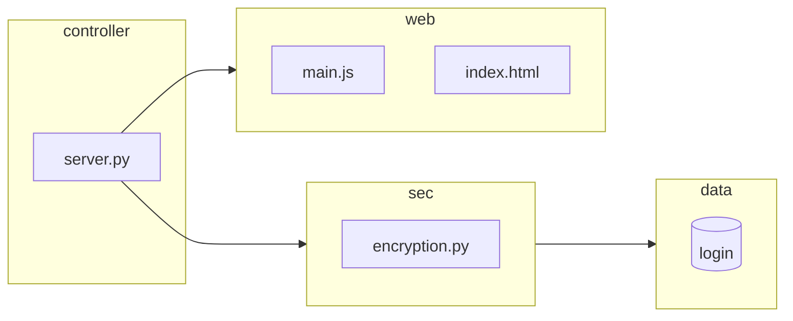

# Web-App

basic Fastapi framework with js/hmtl/css Forntend 
(we dont need a great Framework for this). However we should manage acces!
Therefore I will add an encryption and a user Table in a SQLite3 DB so we can
be sure only the server Admin and no other person in its subnet can acces the Interface

Login 



## Aktueller Frontend-Stand

`/` liefert `web/index.html`; `/general` liefert die separate
`web/general.html`. CSS und JavaScript werden unter `/web/main.css`,
`/web/main.js` und `/web/general.js` geladen. Die Startseite fragt beim Laden und
über `Reload`
`GET /load_all_servers` ab. Der Endpunkt liefert `{"data": [...]}`: eine Liste
aus der `database_deamon`-Tabelle und je Container `errors` und `problems` aus
`database_deamon_errors`. Die Abfrage und Aufbereitung liegt in
`Database.get_docker_container_data()` in `data/get_data.py`; FastAPI ruft diese
Methode auf.

Ein Eintrag enthält die Datenbankfelder `id`, `name`, `status`, `importance`,
`type`, `last_updated` und `version`. Dazu kommen `errors` und die daraus
ermittelte Problemzahl `problems`. Die Karten zeigen diese DB-Informationen
direkt an; kein Docker-Container ist im Frontend fest eingetragen. Ein kleiner
roter Punkt markiert Container mit Problemen. Ein Klick auf den Namen öffnet
die Fehlerdetails mit Navigation durch die Fehler und dem AI-Antwortbereich.
Die Navigation `general` öffnet die Systemübersicht auf einer separaten Seite.
Das Logo stammt aus `web/assets/logo.svg`; solange die Datenbank leer ist,
erscheint eine leere Liste.

Die `general`-Seite fragt ausschließlich `GET /load_sys_info` ab. Dieser
Endpunkt ruft `Dashboard.get_all_data()` aus `sys_intel/get_sys_info.py` auf und
liefert dessen JSON mit Benutzer, Datum/Uhrzeit, CPU/Kernen, RAM, Datenträger
und Netzwerk. Die Werte werden auf der Seite in Systemkarten und
Fortschrittsanzeigen strukturiert dargestellt. Für die Systeminformationen wird
`psutil` benötigt.

Zum lokalen Anzeigen der Oberfläche im Repository-Root:

```bash
python data/help__init_db.py
python -m uvicorn controller.server:app --host 127.0.0.1 --port 9000
```

Danach `http://127.0.0.1:9000/` im Browser öffnen. Für `uvicorn`, FastAPI und
die Systemübersicht muss `psutil` installiert sein.